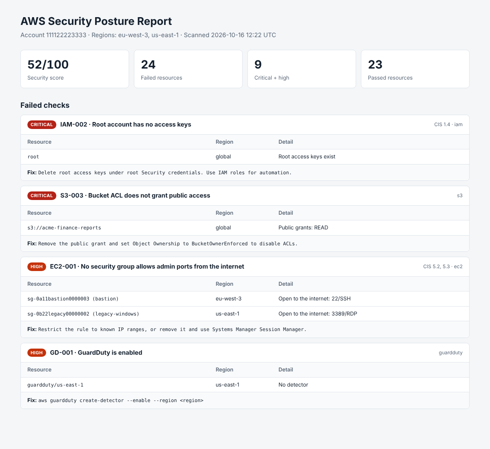
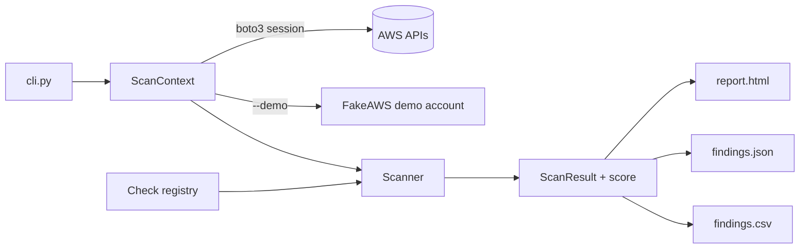

# AWS Security Scanner


A Python tool that audits an AWS account for common security misconfigurations, mapped to the **CIS AWS Foundations Benchmark v3.0**. It runs **21 read-only checks** across IAM, S3, EC2, VPC, CloudTrail and GuardDuty, scores the account, and writes an **HTML report, JSON and CSV** with a fix for every finding.

It includes a built-in **demo account**, so you can see real output without AWS credentials.



## Checks

| ID | Check | Severity | CIS v3.0 |
|---|---|---|---|
| IAM-001 | Root account has MFA enabled | critical | 1.5 |
| IAM-002 | Root account has no access keys | critical | 1.4 |
| IAM-003 | Console users have MFA | high | 1.10 |
| IAM-004 | Active access keys rotated within 90 days | medium | 1.14 |
| IAM-005 | Password policy (length 14+, reuse prevention 24) | medium | 1.8, 1.9 |
| IAM-006 | Users get permissions only through groups | medium | 1.15 |
| IAM-007 | IAM Access Analyzer enabled (per region) | low | 1.20 |
| S3-001 | Account-level Block Public Access on | high | 2.1.4 |
| S3-002 | Bucket-level Block Public Access on | high | 2.1.4 |
| S3-003 | Bucket ACL does not grant public access | critical | |
| S3-004 | Bucket policy enforces HTTPS | medium | 2.1.1 |
| S3-005 | Bucket versioning enabled | low | |
| EC2-001 | No security group exposes SSH/RDP to 0.0.0.0/0 or ::/0 | high | 5.2, 5.3 |
| EC2-002 | Default security groups have no rules | medium | 5.4 |
| EC2-003 | EBS encryption by default | medium | 2.2.1 |
| EC2-004 | Instances require IMDSv2 | medium | 5.6 |
| VPC-001 | VPC flow logs enabled | medium | 3.7 |
| CT-001 | A multi-region CloudTrail trail is logging | critical | 3.1 |
| CT-002 | CloudTrail log file validation | medium | 3.2 |
| CT-003 | CloudTrail encrypted with KMS | medium | 3.5 |
| GD-001 | GuardDuty enabled (per region) | high | |

## Quick start

```bash
git clone https://github.com/<your-github-username>/aws-security-scanner.git
cd aws-security-scanner
python -m venv .venv && source .venv/bin/activate   # Windows: .venv\Scripts\activate
pip install -r requirements.txt

# Try it without AWS
python -m awsscan scan --demo
```

```
Account 111122223333 | regions: eu-west-3, us-east-1
Security score: 52/100   PASS 23   FAIL 24   ERROR 0

Failed checks (most severe first):
  [CRIT] IAM-002  global     root                                     Root access keys exist
  [CRIT] S3-003   global     s3://acme-finance-reports                Public grants: READ
  [HIGH] EC2-001  eu-west-3  sg-0a11bastion0000003 (bastion)          Open to the internet: 22/SSH
  [HIGH] EC2-001  us-east-1  sg-0b22legacy00000002 (legacy-windows)   Open to the internet: 3389/RDP
  [HIGH] GD-001   us-east-1  guardduty/us-east-1                      No detector
  ...
Reports written to reports/ (report.html, findings.json, findings.csv)
```

Full sample output: [`docs/sample-output/`](docs/sample-output/).

## Scanning a real account

1. Create an IAM role or user with the least-privilege policy in [`iam-policy/awsscan-readonly.json`](iam-policy/awsscan-readonly.json). It only allows read calls. AWS's managed `SecurityAudit` policy also works.
2. Configure credentials (`aws configure --profile audit` or `aws sso login`).
3. Run:

```bash
python -m awsscan scan --profile audit --regions eu-west-3,us-east-1
python -m awsscan scan --profile audit --services s3,iam
python -m awsscan scan --profile audit --fail-on high   # exit code 2 if any high/critical check fails
python -m awsscan list-checks
```

Without `--regions`, every enabled region is scanned. Checks that are denied by IAM are reported as `ERROR` and the rest of the scan continues.

To run it every week from GitHub Actions without storing AWS keys, see [`examples/scheduled-scan.yml`](examples/scheduled-scan.yml), which uses OIDC to assume a read-only role.

## Design



- **Checks are small generator functions** registered with a decorator that carries the metadata (ID, severity, CIS reference, remediation). Adding a check means writing one function in `awsscan/checks/`.
- **Checks never import boto3.** They ask a `ScanContext` for clients. In production the context wraps a boto3 session with adaptive retries; in tests and `--demo` it returns fake clients backed by a dictionary. That keeps the test suite fast, offline and free.
- **Global checks** (IAM, S3, CloudTrail) run once. **Regional checks** (EC2, VPC, GuardDuty, Access Analyzer) run in every scanned region.
- **The score** is a severity-weighted pass rate: critical counts 10, high 5, medium 3, low 1.

Example check:

```python
@check(id="EC2-003", title="EBS encryption by default is enabled", service="ec2",
       severity="medium", cis="2.2.1",
       remediation="aws ec2 enable-ebs-encryption-by-default --region <region>")
def ebs_default_encryption(ctx, region):
    enabled = ctx.client("ec2", region).get_ebs_encryption_by_default()["EbsEncryptionByDefault"]
    yield Result(enabled, f"ebs-default/{region}", "Enabled" if enabled else "Disabled")
```

## Testing

```bash
pip install -r requirements-dev.txt
pytest -v
```

22 tests cover each check's pass and fail paths, edge cases (port ranges such as 3380-3390 include RDP, inactive keys are ignored, `get_trail_status` must be called in the trail's home region), error handling when a call is denied, the reports and the CLI exit codes. One test records every AWS call made during a full scan and fails if the shipped IAM policy does not allow it.

## Roadmap

- More checks: RDS public snapshots, KMS key rotation, Lambda public URLs, unused IAM credentials (credential report)
- AWS Organizations support to scan every member account by assuming a role
- Send findings to AWS Security Hub in ASFF format

## License

MIT
